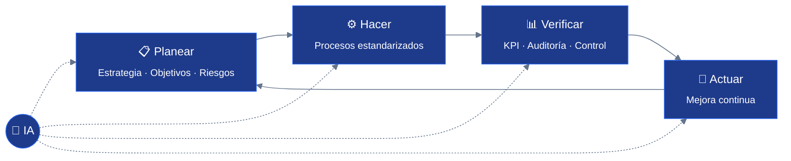

<!-- ═══════════════════════════ HEADER ═══════════════════════════ -->
<p align="center">
  
</p>

<p align="center">
  <a href="#-sobre-mí">
    
  </a>
</p>

<p align="center">
  
  
  
  
</p>

---

## 🧭 Sobre mí

Administrador de empresas, **especialista en Gerencia de Proyectos** y egresado del **Programa de Desarrollo Integral (PID) de INALDE Business School**.

Lidero el **equipo de Excelencia Operativa**, donde estoy transformando el **Sistema de Gestión de Calidad** para integrarlo con **tecnología e inteligencia artificial**: procesos más ágiles, trazables y medibles, sin perder el rigor del control y el cumplimiento.

Mi enfoque es **estratégico**: conectar la planeación con la ejecución, y convertir cada proceso en una fuente de datos para decidir mejor.

```yaml
rol:         Líder de Excelencia Operativa
enfoque:     [Calidad, Procesos, Planeación, Cumplimiento, Control Interno]
misión:      Adaptar el Sistema de Gestión de Calidad a la era de la IA
principio:   "Lo que no se mide, no se mejora."
```

---

## 🎯 Áreas de enfoque

<table>
  <tr>
    <td width="50%" valign="top">
      <h4>🔷 Calidad &amp; Procesos</h4>
      Diseño, documentación y estandarización de procesos. Sistemas de Gestión de Calidad, gestión documental y auditoría orientada a valor.
    </td>
    <td width="50%" valign="top">
      <h4>🤖 IA aplicada a la gestión</h4>
      Automatización de flujos, asistentes con IA para procedimientos, análisis de indicadores y agentes que reducen trabajo operativo repetitivo.
    </td>
  </tr>
  <tr>
    <td width="50%" valign="top">
      <h4>🛡️ Control interno &amp; Cumplimiento</h4>
      Gestión de riesgos, controles trazables, seguimiento a planes de acción y preparación para auditorías internas y externas.
    </td>
    <td width="50%" valign="top">
      <h4>📈 Planeación &amp; Productividad</h4>
      Planeación estratégica, gestión de proyectos, tableros de indicadores (KPI) y cultura de mejora continua.
    </td>
  </tr>
</table>

---

## 🔄 Cómo trabajo: mejora continua + IA



---

## 🧰 Stack & metodologías

<details open>
<summary><b>📐 Metodologías y marcos de referencia</b></summary>
<br/>

<p>
  
  
  
  
  
  
  
  
</p>
</details>

<details>
<summary><b>🤖 Inteligencia artificial y automatización</b></summary>
<br/>

<p>
  
  
  
  
</p>
</details>

<details>
<summary><b>📊 Productividad, datos y colaboración</b></summary>
<br/>

<p>
  
  
  
  
  
  
</p>
</details>

---

## 🔭 En qué estoy trabajando

<details>
<summary><b>Ver iniciativas actuales</b></summary>
<br/>

| Iniciativa | Objetivo | Estado |
|:--|:--|:--:|
| 🧾 **SGC + IA** | Adaptar procedimientos, formatos e instructivos del Sistema de Gestión de Calidad a herramientas de IA |  |
| 🤖 **Asistentes de procesos** | Agentes que guían la ejecución de procesos y responden consultas sobre la documentación |  |
| 📊 **Indicadores inteligentes** | Seguimiento automatizado de KPI y alertas tempranas de desviaciones |  |
| 🛡️ **Control interno digital** | Evidencias trazables, seguimiento de planes de acción y preparación de auditorías |  |

</details>

<details>
<summary><b>💡 Principios que guían mi trabajo</b></summary>
<br/>

- **Primero el proceso, después la herramienta.** La IA amplifica procesos bien diseñados; no corrige los mal diseñados.
- **Trazabilidad por defecto.** Toda automatización debe dejar evidencia y ser auditable.
- **Mejora continua, no proyectos aislados.** Pequeñas mejoras medibles, sostenidas en el tiempo.
- **Las personas en el centro.** La tecnología libera tiempo para pensar, decidir y servir mejor.

</details>

---

## 📊 Actividad en GitHub

<p align="center">
  
  
</p>

---

## 🤝 Conectemos

<p align="center">
  <a href="https://www.linkedin.com/in/TU-USUARIO-LINKEDIN/">
    
  </a>
  <a href="https://github.com/jmiguelmartinezm-cloud">
    
  </a>
</p>

<p align="center">
  <sub>💬 Pregúntame sobre <b>calidad</b>, <b>procesos</b>, <b>control interno</b> o cómo llevar la <b>IA</b> a la operación de una empresa.</sub>
</p>

<p align="center">
  
</p>
